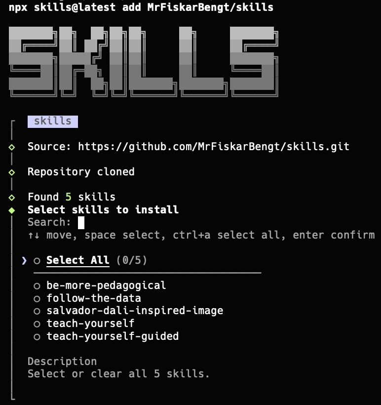

# Skills

Small, reusable instructions that help an AI agent approach a task. Each skill lives in its own folder, with a `SKILL.md` that says when to use it and what to do.

## Skills

- [Be more pedagogical](skills/be-more-pedagogical/) — explain ideas clearly, at the reader's level.
- [Document a skill](skills/document-skill/) — add or update a skill in this repository.
- [Follow the data](skills/follow-the-data/) — trace data through a system to diagnose unexpected behavior.
- [Teach yourself](skills/teach-yourself/) — use explanation to uncover gaps in reasoning before acting.

## Drafts

> [!IMPORTANT]
> **DRAFT · BETA SKILLS** — These skills are available to try while their instructions and behavior are still being refined.

- [Design evolving systems](drafts/design-evolving-systems/) — design a system and the process people and agents will use to build and evolve it.

To try a draft, ask your agent to install it from its linked folder on the `master` branch. Maintainers can add future drafts under `drafts/<skill-name>/SKILL.md` and list them here.

## Install

Ask your AI agent:

```text
Install the be-more-pedagogical skill from https://github.com/MrFiskarBengt/skills for my AI agent.
```

Replace the skill name with any skill above. Your agent can choose the appropriate installation method and location; start a new session if needed.

Alternatively, use [skills.sh](https://skills.sh/) to choose skills and agents:

```sh
npx skills@latest add MrFiskarBengt/skills
```



## Add a skill (for maintainers)

Create `skills/<skill-name>/SKILL.md` with a name, description, and instructions. Add supporting files only when needed, and link the skill in the list above. The [document a skill](skills/document-skill/SKILL.md) skill guides this process.

## License

[MIT](LICENSE)
